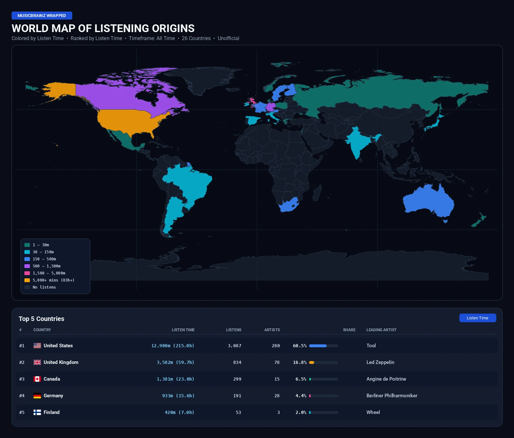
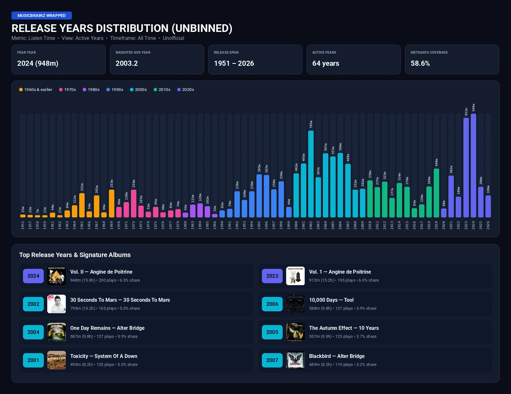

<p align="center">
  
</p>

<h1 align="center">MusicBrainz Wrapped (Unofficial)</h1>

> **Unofficial Community Project — Disclaimer**  
> This project is **unofficial** and is **not affiliated with, endorsed by, sponsored by, or connected to MusicBrainz, ListenBrainz, or the MetaBrainz Foundation**. Everything runs locally on your own machine—your listening history never leaves your PC.

I originally put this together because I was too impatient waiting for the MusicBrainz / ListenBrainz servers to process and integrate my latest listens into periodic reports—and I wanted a much richer interactive dashboard and visual export studio that I could explore and share on demand.

---

## Start Here: Launching the Local Web App (Main Workflow)

Running the local HTTP server and opening the dashboard in your browser is the **main way** to use MusicBrainz Wrapped—to browse your listening statistics, filter timeframes, drill down into artists/albums, sync new data, and export only the graphics you choose.

### 1. Install Dependencies & Start the Local Server

```bash
pip install -r requirements.txt
./start.sh
# or directly: python3 server.py
# optional custom port: ./start.sh 9000
```

### 2. Open in Your Browser

* Open **`http://localhost:8080`** in Firefox (or any modern browser). `./start.sh` also tries opening it automatically via `xdg-open`.
* **Phone / LAN access:** Open `http://<your-computer-ip>:8080` from any device on your local network.

### What You Can Do in the Dashboard

* **Global Metric & Time Controls:** Toggle between **Listen Time** (minutes/hours, default) and **No. of Listens**, pick listening-year or month presets, or scrub the dual-thumb **Time Interval** slider across all charts and exports.
* **7 Interactive Analytics Tabs:** **Album Compilation** (Tiered Bento or Uniform Grid), **Top Artists**, **Top Songs**, **Top Albums**, **Release Years** (unbinned year-by-year, Spotify-style **Listening Age** from weighted avg. year, Year Spotlight & Ledger), **World Map** (hover/tap country stats + Top X table + live **Include Pie Chart** donut panel), and **Listening Habits** (24h clock, weekday rhythm, monthly trend).
* **Click-Through Drilldowns:** Click any album cover, artist card/row, track, or release-year chip to inspect full release/track breakdowns.
* **On-Demand Exports Only:** Nothing is auto-generated onto disk when syncing or browsing. Tick any combination of **`WebP`**, **`AVIF`** (full-resolution `4:4:4` chroma), **`JPG`**, or **`JXL`**, optionally toggle **Include Flags** (off by default), then either click **Export Top N / Export Graphic** inside any view or click **Export All Graphics** on the right of the Export Formats bar to download all 5 graphics bundled as a `.zip`.

---

## Automatic Listening Data Retrieval (ListenBrainz Export API)

Instead of manually requesting and downloading a ZIP archive from ListenBrainz every time you want fresh listens, MusicBrainz Wrapped can **trigger ListenBrainz's official Export API (`https://api.listenbrainz.org/1/export/`)** directly from the dashboard—fetching the exact same archive you get from `listenbrainz.org/settings/export/`, downloading it into `imports/`, extracting it, and syncing your local SQLite database automatically.

### How to Set Up & Use Automatic Retrieval

1. Sign in to ListenBrainz and open **[listenbrainz.org/settings/](https://listenbrainz.org/settings/)**.
2. Copy your **User Token** from the User Settings page *(no password or browser cookies are ever needed)*.
3. In your local MusicBrainz Wrapped dashboard (`http://localhost:8080`), click **Data Source** in the top bar.
4. Under **Automatic ListenBrainz Sync (Official Export API)**:
   * Paste your **User Token** into the masked password field.
   * Optionally tick **Remember locally in gitignored `data/config.json` (chmod 600)** if you want future sessions to reuse it automatically *(leave unticked to keep it in server RAM for the current session only, or click **Forget** anytime to erase it)*.
   * Click **Fetch & Import Latest Export**.
5. MusicBrainz Wrapped queues the export on ListenBrainz (or attaches to an already-pending job), polls respectfully until ListenBrainz finishes compiling, streams the `.zip` into `imports/`, extracts it safely, and reloads your dashboard automatically once imported.

**Terminal / Environment Variable Option:** You can also supply your token without typing it in the browser:
```bash
export LISTENBRAINZ_USER_TOKEN="your-listenbrainz-user-token"
./start.sh
```

**Credential Safety Guarantees:**
* Your token is **never** returned by any `GET` API endpoint (only masked previews such as `••••1234`), never written to logs or error messages, and never committed to Git (`data/config.json` is excluded in `.gitignore` and written with `0600` owner-only permissions).

### Manual Import Alternatives

If you prefer offline/manual imports from **[listenbrainz.org/settings/export/](https://listenbrainz.org/settings/export/)**:
1. **Drop into `./imports/`:** Place the `.zip` / `.tar.gz` archive or extracted folder inside [`imports/`](imports/README.md), then click **Sync Data** or choose it in **Data Source**.
2. **Drag-and-Drop Upload:** Drag your `.zip` / `.tar.gz` file into the upload box inside **Data Source**.
3. **Custom Local Path or CLI:** Enter any folder path in **Data Source** (auto-discovered folders also include `~/Documents/Music Library/listenbrainz_*`, `~/Downloads/listenbrainz_*`, and `~/Music/listenbrainz_*`), or run:
   ```bash
   python3 visualize.py --sync --data-dir "/path/to/listenbrainz_YourName_1794214563"
   ```
   *(Syncing only updates the database—no image files are auto-generated unless you pass an explicit export flag.)*

---

## Showcase Exports

All five exportable graphic types generated as WebP snapshots from local listening history:

### 1. Top 101 Album Collage (`static/top_albums_collage_101.webp`)
Displays your top 101 albums arranged in a gapless **Tiered Bento** layout (`#1–#3` large Hero row, `#4–#11` two Medium rows of 4, and `#12–#101` Compact rows of 5) with rank badges, release years, artist names, and listen time / play counts overlaid on each cover *(optional country flags can be enabled with **Include Flags**)*.

<p align="center">
  
</p>

### 2. Top 50 Artists & Top 50 Songs Wrapped (`static/top_50_artists.webp`, `static/top_50_songs.webp`)
* **Top 50 Artists:** 1600px editorial dark-glass poster with an ambient studio-lit gradient backdrop, project logo in the top-right corner, an elevated centerpiece Gold `#1` / Silver `#2` / Bronze `#3` podium with blurred portrait washes, and a 2-column `#4–#50` grid of proportional gradient bars, circular portraits, and a balanced summary card.
* **Top 50 Songs:** Matching editorial podium + 2-column track poster showcasing album cover thumbnails, track title, artist + album metadata, total listen time, and track duration × play-count context (`MM:SS × Np`).

| Top 50 Artists Wrapped | Top 50 Songs Wrapped |
| :---: | :---: |
|  |  |

### 3. World Map of Listening Origins (`static/world_map.webp`)
Renders a high-resolution vector choropleth world map colored by listening intensity (or unique artist count) across MusicBrainz/ListenBrainz MBID-attributed artist origin countries, complete with a color-scale legend, a ranked **Top Countries** table (listen time, total listens, unique artists, percentage share bar, and leading artist per country), and the **Country Share Breakdown** donut pie chart when **Include Pie Chart** is checked.

<p align="center">
  
</p>

### 4. Unbinned Release Years Distribution (`static/release_years.webp`)
Plots every individual original album release year without decade-binning—paired with a 6-card KPI summary strip (**Peak Year**, **Weighted Avg Year**, **Listening Age**, **Release Span**, **Active Years**, **Metadata Coverage**), era color coding (1960s through 2020s), exact per-year totals, and **Top Release Years & Signature Albums** cards featuring the top album cover and listening share for your strongest release years.

<p align="center">
  
</p>

---

## Why Top 101, Top 51, Top 31? (Gapless Grid Math)

In **Tiered Bento** mode, album covers are sized by rank so your favorites stand out without leaving awkward blank slots on the bottom row:

| Tier | Ranks | Layout | Subtotal |
| :--- | :--- | :--- | :---: |
| **Hero Tier** | `#1 – #3` | 1 row × 3 large tiles | **3** |
| **Medium Tier** | `#4 – #11` | 2 rows × 4 medium tiles | **11** |
| **Compact Tier** | `#12+` | *k* rows × 5 compact tiles | `11 + 5k` |

Adding complete 5-tile compact rows gives gapless presets of **Top 11, 16, 21, 26, 31, 41, 51, 76, and 101**—so every generated collage ends on a full, balanced row. **Uniform Grid** mode adjusts to gapless rectangular grids: **Top 9 (3×3)**, **Top 16 (4×4)**, **Top 20 (5×4)**, **Top 25 (5×5)**, **Top 30 (5×6)**, **Top 50 (5×10)**, and **Top 100 (5×20)**.

---

## Optional CLI Usage

```bash
# Terminal summary & top 30 by listen time (no images generated automatically)
python3 visualize.py

# Sync a local export folder without generating images
python3 visualize.py --sync --data-dir "/path/to/listenbrainz_YourName_1794214563"

# Export specific graphics on demand (formats: webp, avif, jpg, jxl; add --flags for inline country flags)
python3 visualize.py --collage --limit 51 --formats webp,avif
python3 visualize.py --map-graphic --pie --formats webp
python3 visualize.py --years-graphic --formats webp

# Export all 5 showcase graphics at once
python3 visualize.py --export-all --formats webp --pie

# Re-verify artist origin countries via ListenBrainz/MusicBrainz APIs
python3 visualize.py --refresh-countries
```

---

## Performance & Architecture

- **SQLite Analytics (`db.py`)**: WAL-mode SQLite queries (`listenbrainz.db`) with single-pass aggregations for release years (including Listening Age) and countries.
- **Automated Export Client (`listenbrainz_export.py`)**: Async background worker interfacing with `api.listenbrainz.org/1/export/` with masked credential handling, pending-job reuse, rate-limit backoff, and streaming ZIP download.
- **Authoritative Enrichment & Rendering (`importer.py`, `collage_generator.py`)**: Backfills `artist_mbid` metadata, resolves artist countries via ListenBrainz batch `/1/metadata/artist/` + rate-limited MusicBrainz WS2 lookups, parallelizes artwork/year enrichment, and renders editorial `4:4:4` AVIF/WebP/JPG/JXL posters with PyMuPDF-rasterized SVG maps, pie charts, and flags.
- **Lightweight Frontend (`static/`)**: Vanilla HTML5, CSS3, SVG, and ES6+ JavaScript with zero build step and self-hosted SVG flags (`static/flags/`).

---

## License

Released under the [MIT License](LICENSE).
