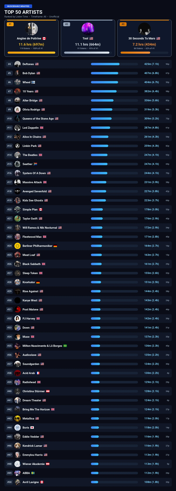
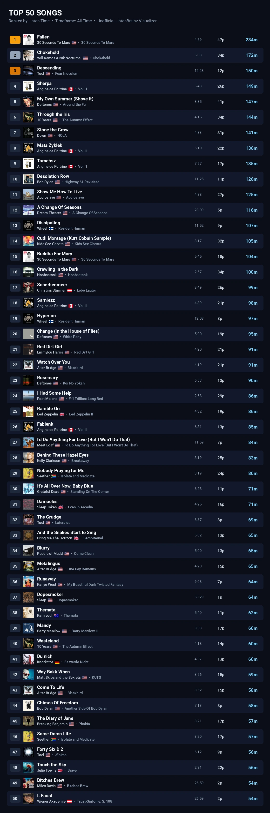
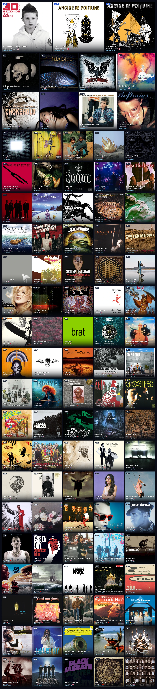

# ListenBrainz Local Visualizer (Unofficial)

> **Unofficial Community Project — Disclaimer**  
> This project is **unofficial** and is **not affiliated with, endorsed by, sponsored by, or connected to ListenBrainz, MusicBrainz, or the MetaBrainz Foundation**. All data stays 100% local on your machine.

I built this because I was too impatient waiting for the MusicBrainz / ListenBrainz servers to process and integrate my latest listens into periodic stats—and I wanted a much richer, faster, interactive local visualization studio for my listening history, which I want to share.

---

## Key Features

- **Count by Listen Time or No. of Listens**: Switch globally between **Listen Time** (minutes/hours, default) and **No. of Listens** across all leaderboards, charts, release years, world map, drilldowns, and image exports.
- **Inline Country Flags (Toggleable)**: Crisp vector SVG flags rendered **inline next to artist names** everywhere (web tables, album collages, drilldowns, and exported images), with an **Include Flags** toggle (enabled by default).
- **Multi-Format Image Exports (`WebP`, `AVIF`, `JPG`, `JXL`)**: Tick any combination of formats (**WebP** selected by default) to generate mobile-readable Tiered Bento or Uniform Album Collages (`Top 10` to `Top 101`) and portrait Top 50 Artists / Songs graphics in a single pass.
- **Interactive World Map & Country Breakdown**:
  - Choropleth map shaded by listen time, play count, or unique artist count (including France, Norway, Taiwan, and Kosovo vector geometry).
  - Hoverable (and mobile tap-friendly) tooltips showing rank, total listening time, listens, share percentage, and top artists per country.
  - Configurable **Top X Countries** statistics table (`Top 5` by default) and an optional **Country Pie Chart** toggle.
- **Unbinned Release Year Analytics**:
  - Individual release-year bars (never binned by decade) with **Active Years** and **Full Timeline** view modes.
  - Peak year, weighted mean release year, year span, metadata coverage summary, interactive year spotlight, and a full year-by-year ledger table.
- **Interactive Time Controls & Drilldowns**: Filter by listening year, month, or custom date-range slider; click any artist, album, or release-year album chip to inspect track-level breakdowns.
- **Mobile-Readable UI & Exports**: Responsive card layouts for narrow phone screens and full-resolution portrait/bento image exports that stay legible on mobile displays.

---

## How to Export Your ListenBrainz Data

1. Sign in to ListenBrainz and open **[listenbrainz.org/settings/export/](https://listenbrainz.org/settings/export/)**.
2. Click **Export listens** to generate your listening history archive.
3. Download the resulting `.zip` file (for example, `listenbrainz_YourName_1794214563.zip`).

### Easy Ways to Load Your Data

1. **Drop it into `./imports/`** *(recommended)*: Place either the downloaded `.zip` / `.tar.gz` archive or the extracted `listenbrainz_*` folder into the [`imports/`](imports/README.md) directory.
2. **Use the Web UI's `Data Source` button**:
   - Auto-discovers exports inside `./imports/`, `~/Documents/Music Library/listenbrainz_*`, and `~/Downloads/listenbrainz_*`.
   - Upload a `.zip` / `.tar.gz` archive directly in the browser (automatically extracted safely into `imports/`).
   - Or paste any custom folder path and click **Load & Sync**.
3. **Or pass it via CLI**:
   ```bash
   python3 visualize.py --sync --data-dir "/path/to/listenbrainz_YourName_1794214563"
   ```

---

## Quick Start

### 1. Install Dependencies

Requires **Python 3.10+** and `Pillow` (plus optional `PyMuPDF` for vector-sharp flag rasterization inside exported images, and optional system `cjxl` / `libjxl` if you want `.jxl` exports):

```bash
pip install -r requirements.txt
```

### 2. Import Your Listens & Launch the Web Studio

```bash
# Optional: sync from CLI first (or load directly inside the web UI via Data Source)
python3 visualize.py --sync

# Start the local web server
python3 server.py
```

Then open **http://localhost:8080** in your browser (or access it on your phone over your local network at `http://<your-pc-ip>:8080`).

### 3. CLI Usage Examples

```bash
# Show summary & top 30 by listen time (default)
python3 visualize.py

# Rank by number of listens for a specific year
python3 visualize.py --metric plays --timeframe 2026 --limit 50

# Export Top 101 Collage, Top 50 Artists, and Top 50 Songs in WebP + JPG
python3 visualize.py --export-all --formats webp,jpg

# Export without country flags
python3 visualize.py --export-all --formats webp --no-flags
```

---

## Showcase Exports

Sample exports generated with the default **WebP** format and **Include Flags** enabled:

| Top 50 Artists | Top 50 Songs | Top 101 Album Collage |
| :---: | :---: | :---: |
|  |  |  |

---

## Performance & Architecture Notes

- **SQLite Analytics Engine (`db.py`)**: Uses indexed WAL-mode SQLite queries (`listenbrainz.db`) with single-query aggregation for release years and countries, serving all dashboard endpoints in ~120 ms total.
- **Parallel Metadata & Image Pipeline (`importer.py`, `collage_generator.py`)**:
  - Multi-threaded `ThreadPoolExecutor` lookups for artist portraits, Cover Art Archive / Deezer album artwork, original album release years, and artist origins, persisting `*_fetched` flags so incremental syncs stay fast.
  - Single-render multi-format image export: builds the Pillow canvas once using cached fonts, gradient overlays, and masks, then encodes ticked formats (`webp`, `avif`, `jpg`, `jxl`) concurrently.
- **Zero Heavy JS Frameworks**: Pure HTML5, CSS3, SVG, and vanilla ES6+ JavaScript (`static/`), plus self-hosted SVG flag assets (`static/flags/`).

---

## License

Released under the [MIT License](LICENSE) (or free for personal and community use).
